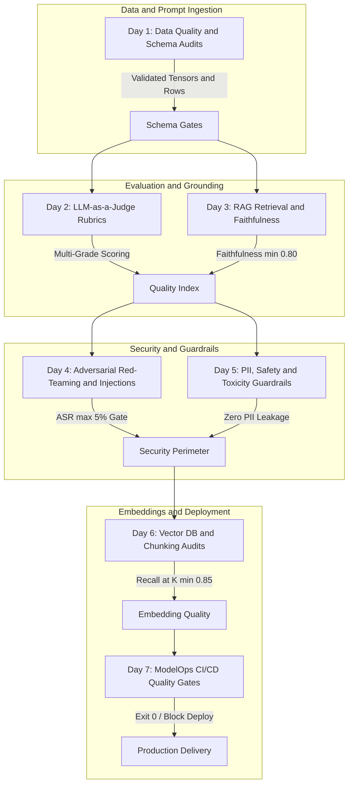

# Data Quality & AI/LLM Testing Reference Suite (Days 1–7)

[](LICENSE)
[](https://www.python.org/)
[]()
[]()

A comprehensive, production-grade reference repository demonstrating hands-on Quality Engineering (QE) strategies for modern Large Language Model (LLM) and Generative AI applications. 

Designed for **LLM Quality Architects**, **Data QA Engineers**, and **AI SecOps Architects**, this repository implements 7 consecutive daily hands-on modules addressing data drift, automated rubric evaluations, RAG grounding, adversarial injection attacks, PII filtering, vector search recall, and ModelOps CI/CD regression gates.

---

## 🏛️ Architecture & Verification Pipeline



---

## 📅 7-Day Curriculum Overview

| Day | Lab Directory | Focus Area | Core Tech & Strategy | Primary Assertion |
| :---: | :--- | :--- | :--- | :--- |
| **Day 1** | `day-1-data-quality-schema-auditing` | Shift-Left Data Quality | Great Expectations Pattern, Schema Checks, Null Bounds | Dataset validity == 100%, 0 format errors |
| **Day 2** | `day-2-llm-judge-rubrics` | LLM-as-a-Judge | Structured JSON Rubrics, Chain-of-Thought Grading | Inter-annotator agreement >= 0.85 |
| **Day 3** | `day-3-rag-evaluation-deepeval` | RAG Evaluation & Grounding | DeepEval / Ragas Metrics, Context Precision/Recall | Faithfulness >= 0.80, Relevancy >= 0.75 |
| **Day 4** | `day-4-red-teaming-prompt-injection` | Adversarial Security | Jailbreak Detectors, DAN/Roleplay Attack Harness | Attack Success Rate (ASR) < 5% |
| **Day 5** | `day-5-pii-safety-guardrails` | Privacy & Safety Filtering | Regex/Token Redaction, Toxicity Guardrails | 0 plaintext PII leaks, 100% toxic catch |
| **Day 6** | `day-6-vectordb-embedding-audits` | Vector DB & Embedding Recall | In-Memory Vector Store, Cosine Similarity, Overlap | Top-K Recall@3 >= 0.85 |
| **Day 7** | `day-7-modelops-cicd-gates` | ModelOps CI/CD Automation | Unified Eval Gate, SARIF/JSON Reports, GitHub Actions | Quality Index >= 0.80 -> Exit 0 |

---

## 🚀 Quickstart & Execution

### Prerequisites
- Python 3.10 or higher.
- No external accounts, paid API keys, or Docker containers are strictly required. All tests run **100% offline and cost-free** out of the box using deterministic local evaluator engines.

### 1. Run Complete 7-Day Test Suite (Empirical Verification)
Execute the unified test runner to execute and benchmark all 7 days in seconds:
```bash
python3 test_runner.py
```
Or use the shell wrapper:
```bash
chmod +x run_all_labs.sh
./run_all_labs.sh
```

### 2. Run Individual Day Labs
Each day is completely isolated and self-contained:
```bash
# Day 1: Data Quality & Schema Audits
python3 -m unittest day-1-data-quality-schema-auditing/test_day1_data_quality.py

# Day 2: LLM-as-a-Judge Evaluation Rubrics
python3 -m unittest day-2-llm-judge-rubrics/test_day2_llm_judge.py

# Day 3: RAG Retrieval & Faithfulness Metrics
python3 -m unittest day-3-rag-evaluation-deepeval/test_day3_rag_eval.py

# Day 4: Adversarial Red-Teaming & Prompt Injections
python3 -m unittest day-4-red-teaming-prompt-injection/test_day4_red_teaming.py

# Day 5: PII, Safety & Toxicity Guardrails
python3 -m unittest day-5-pii-safety-guardrails/test_day5_guardrails.py

# Day 6: Vector Database & Embedding Recall
python3 -m unittest day-6-vectordb-embedding-audits/test_day6_vectordb.py

# Day 7: ModelOps CI/CD Validation Gates
python3 -m unittest day-7-modelops-cicd-gates/test_day7_modelops_gate.py
```

### 3. Optional: Live LLM Provider Integration
If you wish to test with live OpenAI, Anthropic, or Gemini endpoints instead of deterministic local mocks, provide your API key via environment variables:
```bash
export OPENAI_API_KEY="sk-..."
python3 day-2-llm-judge-rubrics/judge_engine.py --live
```

---

## 🛡️ License
MIT © Let's Transform AI & QE Strategy Documentation Project.
